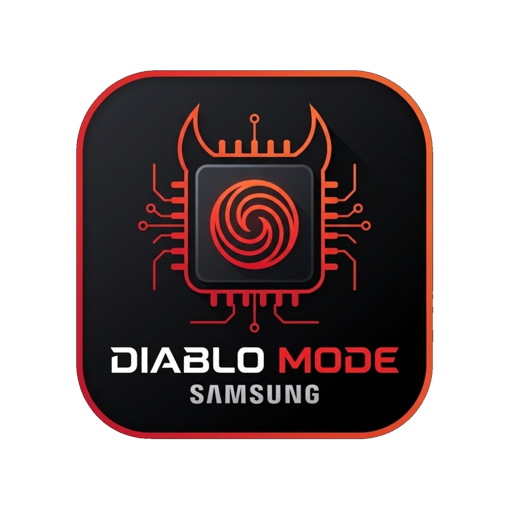

<p align="center">
  
</p>

<h1 align="center">Diablo Mode (Snapdragon)</h1>

<p align="center">
  
  
  
  
  
  <a href="https://hits.sh/github.com/DuduSync/diablo-mode/"></a>
  <a href="https://github.com/DuduSync/diablo-mode/releases"></a>
</p>

<p align="center">Trava CPU e GPU no clock máximo em Snapdragon, só com root.</p>

O app faz via software o que o "Diablo Mode" da RedMagic faz no hardware. Feito para Snapdragon.
Validado no Galaxy S25 Ultra (SM-S938B, Snapdragon 8 Elite for Galaxy, One UI 8.5 / Android 17).

Os nós do sysfs variam por fabricante. Em outros Snapdragon o loop aplica o que existe e ignora o resto, então
pode funcionar em parte. Se algum nó faltar no seu aparelho, abra uma issue com o modelo e o SoC.

## Baixar

APK assinado, sem dependência de módulo. Só instalar e dar root.

➡️ [**Diablo Mode v1.1, Releases**](https://github.com/DuduSync/diablo-mode/releases/latest)

## Aviso

O app desliga a proteção térmica do aparelho. Sessões longas sem cooler esquentam o SoC e desgastam a
bateria mais rápido. Antes de ativar, o app mostra um aviso de 5 segundos. Um watchdog devolve a proteção
térmica quando a GPU passa de 88 °C, algum cluster de CPU passa de 92 °C ou a bateria passa de 46 °C.

## O que ele faz

Os daemons térmicos e de performance do sistema seguram a CPU e a GPU abaixo do máximo mesmo com o chip
frio. Os valores do cap mudam de aparelho para aparelho. O app vence esses daemons com um loop em root que
reaplica o desbloqueio a cada 0.5 a 6 segundos, intervalo configurável no app.

O loop descobre os limites no sysfs na primeira execução. Nenhuma frequência fica fixa no código, então a
mesma build serve para outros Snapdragon.

| Cap | Interface |
|---|---|
| Battery Current Limit (GPU) | `/sys/class/kgsl/kgsl-3d0/bcl` |
| Nível térmico da GPU | `.../thermal_pwrlevel` |
| Teto da GPU | `.../devfreq/max_freq` |
| Cap do kernel na CPU | `/sys/devices/system/cpu/cpufreq_limit/cpufreq_max_limit` |
| Governor e teto da CPU | `policy0`, `policy6` |

Os daemons `thermal-engine`, o HAL térmico da Samsung, o HAL de performance da Qualcomm e o FDE.AI
(quando instalado) voltam sozinhos quando mortos. Por isso matar uma vez não resolve, e o loop é o que
segura.

## Dois modos

TURBO trava min = max no máximo do chip. A CPU e a GPU ficam no topo o tempo todo e esquentam mesmo parado.

AUTO remove os caps e usa `schedutil`. A CPU e a GPU chegam no máximo sob carga e ficam frias quando o
celular está parado.

## Desligar volta ao stock

Ao desligar, o app mata o loop, devolve o governor `walt` da Samsung, restaura a faixa de frequência de
fábrica, reinicia o `thermal-engine` e reativa o FDE.AI.

## Recursos

- Um card por cluster com mínimo, máximo do chip, cap atual e valor atual, além de uma barra e a temperatura colorida.
- Card da bateria com porcentagem, temperatura e estado de carga.
- Switch TURBO / AUTO.
- Slider de intervalo de reaplicação: 0.5, 1, 2, 3, 4, 5 e 6 segundos.
- Contagem de 5 segundos antes de ativar.
- Tela de loading com cache em disco dos índices térmicos e dos últimos valores. O app abre em cerca de 280 ms e já mostra os clocks antes do root responder.

## Requisitos

- Root por KernelSU, KernelSU-Next, Magisk ou APatch. Root temporário também serve.
- Samsung com Snapdragon, Android 13 ou mais novo.
- Cooler recomendado.

## Instalação

1. Baixe o `DiabloMode.apk` na aba Releases.
2. Instale, abra e conceda root quando o KernelSU ou o Magisk pedir.
3. Toque em ATIVAR MODO DIABLO e espere a contagem de 5 segundos.

## Compilar

O app é Kotlin puro, sem projeto de Android Studio. Compila direto com as build tools do SDK. Veja o
[`build.sh`](build.sh).

Precisa de `aapt2`, `d8`, `apksigner`, `zipalign`, `kotlinc`, `kotlin-stdlib.jar`, um `android.jar`
(API 26 ou mais) e JDK 17 ou mais.

```sh
./build.sh caminho/android.jar caminho/kotlin-stdlib.jar
# gera DiabloMode.apk
```

## A parte root

O app leva dois scripts como assets e escreve eles na pasta privada na primeira abertura.

`diablo_loop.sh` é o loop de desbloqueio. Roda solto pelo `su` com `setsid`, continua vivo com o app em
segundo plano e termina quando o arquivo `diablo.on` some. Ele lê o modo (`turbo` ou `auto`) e o intervalo
dos arquivos que a interface escreve, então mudar no app vale na hora.

`status.sh` lê clocks e temperaturas numa chamada de root e imprime `chave=valor`. Ele guarda em cache os
índices das zonas térmicas para não varrer todas a cada atualização.

Nada aqui toca no kernel, na imagem de boot ou em partição. Um reboot volta tudo.

## Testado

| Aparelho | SoC | Android | Resultado |
|---|---|---|---|
| Galaxy S25 Ultra (SM-S938B) | Snapdragon 8 Elite for Galaxy | 17 | CPU em 4.47/3.53 GHz e GPU em 1.2 GHz travadas, 60 fps no Ocarina of Time (Banana Native) |

## Licença

MIT. Veja `LICENSE`. Sem garantia.
